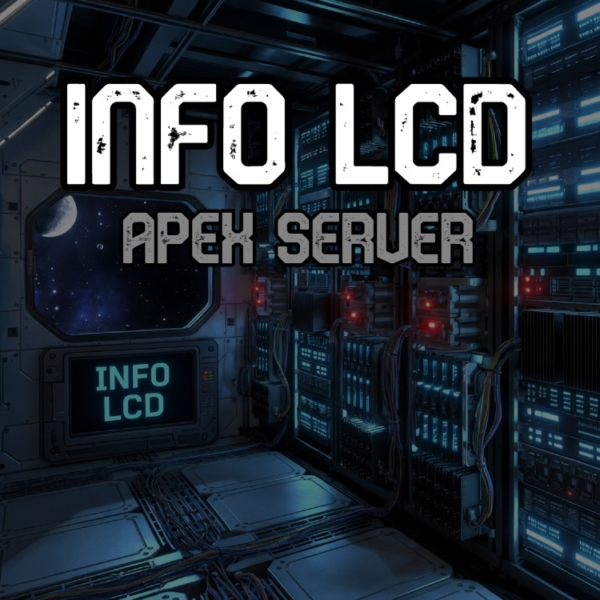

  

  
  
  
  

> **"Consoles can't run scripts, so the server runs them for you."**

**InfoLCD for crossplay servers.** The same LCD apps as [InfoLCD — Apex Update](https://github.com/gitpush-mod/se-infolcd-apex-update), except the server does the work and sends the finished screens to every player. Console players included.

> [!WARNING]
> **Open alpha: not playable yet.** This repo was forked from Apex Update on 2026-10-21, and the server-side conversion hasn't started. Follow along on the [project board](https://github.com/orgs/gitpush-mod/projects/13).

  

## 🧭 Why a separate mod?

Consoles can't run mod scripts. Apex Update's apps run on each player's own machine, so a console refuses to load any world that has it.

This edition runs **only on the server**. It's published with the **Server Scripts** tag, so every player's game skips its code, PC or console. The server draws the screens, and the game syncs them to everyone like any other LCD.

## ✨ What it will show

The same 19 apps as Apex Update, converted in two waves, inventory first:

| Wave | Apps |
|---|---|
| **1** | Components, Cargo, Ingots, Ores, Items, Ammo |
| **2** | Airlock Monitor, Container, Damage Control, Detailed Info, Door Monitor, Farming, Gas Production, Grid & Flight Info, Life Support, Power, Production, Systems, Weapons |

## 🎯 Compatibility (planned)

- ✅ **Crossplay dedicated servers** (Network Type EOS + Console Compatibility, mods from mod.io). This is the main target.
- ✅ **PC dedicated servers and single-player.** The host is the server, so it runs there too.
- ❌ **Console single-player or console-hosted games.** There the console is the server, and consoles can't run scripts.
- ⚠️ **Apex Update or Apex Advanced in the same world.** Not for now: the forked code still registers the same script names. Fixing that is part of the alpha.

## 🚀 Install

Not yet. Test builds will go up on **mod.io as an open alpha**, and this section will get the link and the server-admin steps when they do.

## 🐛 Found a bug?

**[Open an issue with the bug report template](https://github.com/gitpush-mod/se-infolcd-apex-server/issues/new?template=bug_report.md&labels=bug)**. Alpha feedback is exactly what this stage is for.

## 🙌 Credits

- **Author:** [Chris Carpenter (Godimas101)](https://github.com/Godimas101)
- **Built on:** [InfoLCD — Apex Update](https://github.com/gitpush-mod/se-infolcd-apex-update)
- **Alpha testers:** the console players who asked for it, and offered to help test it

## 🧡 Support

InfoLCD is free and always will be. If it saves you time on your next build, consider supporting on **Patreon** — it's more a running project log than a tip jar. Behind-the-scenes updates, in-progress mod work, and dev notes across everything under [`gitpush-mod`](https://github.com/gitpush-mod) and [The Canadian Space](https://thecanadian.space).

---

*Part of the [`gitpush-mod`](https://github.com/gitpush-mod) mod collection. Made with ♥ (and a lot of coffee) by Godimas + Claude.*
